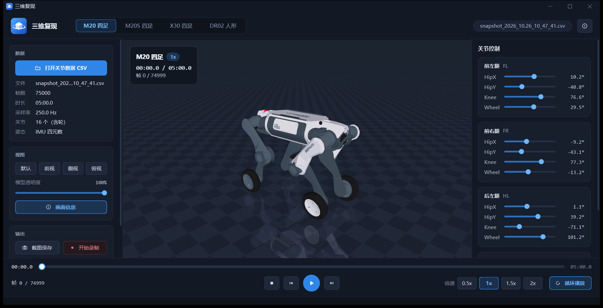

# 三维复现

机器人关节数据三维回放软件。读取 M20 / M20S / X30 四足与 DR02 人形机器人的实测数据（CSV），
用官方高精度原厂配色模型还原整机运动；支持倍速与循环播放、暂停后手动调整关节姿态、截图与录屏。



## 下载

在 [发布页（Releases）](https://github.com/zhangchao-001/replay3d-download/releases/latest) 下载最新版本：

| 系统 | 安装包 |
|---|---|
| Windows 10 / 11（64 位） | `Replay3D-<版本>-x64-Setup.exe` |
| Ubuntu 20.04 / 22.04 / 24.04（x86_64） | `replay3d_<版本>_amd64.deb` |

安装包自带全部运行环境，无需另外安装任何软件。

## 安装

### Windows

- **安装**：双击安装程序，按提示点“下一步”→“安装”。
  首次运行如果提示“Windows 已保护你的电脑”，点“更多信息”→“仍要运行”。
- **启动**：开始菜单或桌面上的“三维复现”。
- **升级**：直接运行新版本的安装程序，自动替换旧版本，软件设置保留。
- **卸载**：设置 → 应用 → 三维复现 → 卸载。

### Ubuntu

在安装包所在目录打开终端：

```
sudo apt install ./replay3d_1.0.0_amd64.deb    # 安装；升级时对新版本安装包执行同一条命令
replay3d                                       # 启动，也可以在应用菜单中打开“三维复现”
sudo apt remove replay3d                       # 卸载
```

## 使用方法

1. **打开数据**：点左侧“打开关节数据 CSV”（Ctrl + O）选择快照文件，软件按表头自动识别机型；
   也可以在顶部切换机型（Ctrl + Tab）。
2. **播放**：底部播放 / 暂停（空格）、逐帧、拖动进度条跳转，倍速 0.5x～2x，可循环播放。
3. **视角**：左键拖动旋转，右键拖动平移，滚轮缩放，双击恢复；左侧可切换默认 / 前视 / 侧视 / 俯视，调整模型透明度。
4. **调整姿态**：暂停后拖动右侧关节滑块手动调整姿态（不修改数据），点还原按钮恢复。
5. **截图与录屏**：截图保存为 PNG（Ctrl + S），录屏保存为 AVI（Ctrl + R），保存目录可在左侧更改。

| 快捷键 | 功能 |
|---|---|
| 空格 | 播放 / 暂停 |
| ← / → | 后退 / 前进 20 帧（按住 Shift 为 100 帧） |
| , / . | 逐帧后退 / 前进 |
| Ctrl + O | 打开数据 |
| Ctrl + S | 截图 |
| Ctrl + R | 开始 / 停止录制 |
| Ctrl + Tab | 切换机型 |
| F1 | 快捷键说明 |

## 校验下载文件

每个安装包都附有同名的 `.sha256` 文件，可核对下载是否完整：

- Windows（PowerShell）：`Get-FileHash .\Replay3D-1.0.0-x64-Setup.exe -Algorithm SHA256`，与 `.sha256` 文件中的值对比
- Ubuntu：`sha256sum -c replay3d_1.0.0_amd64.deb.sha256`
